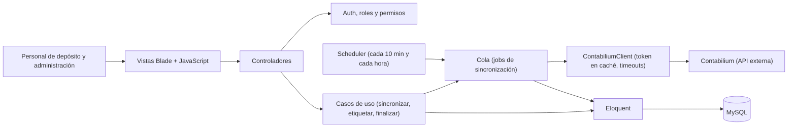
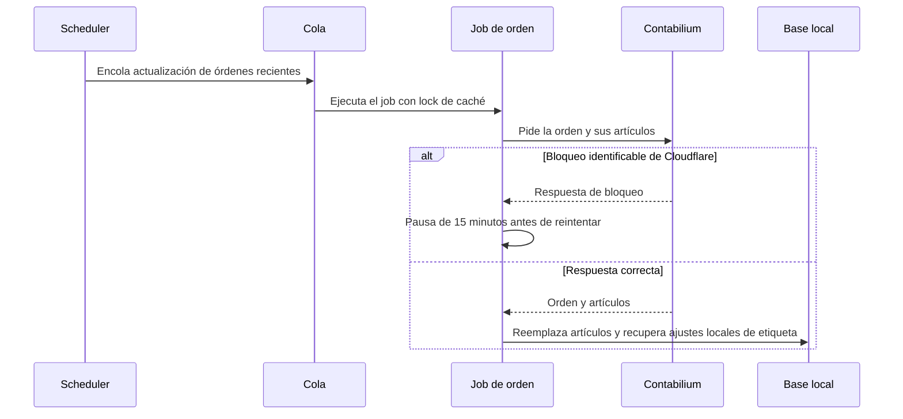
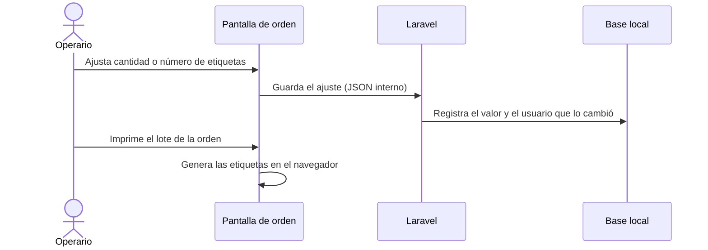
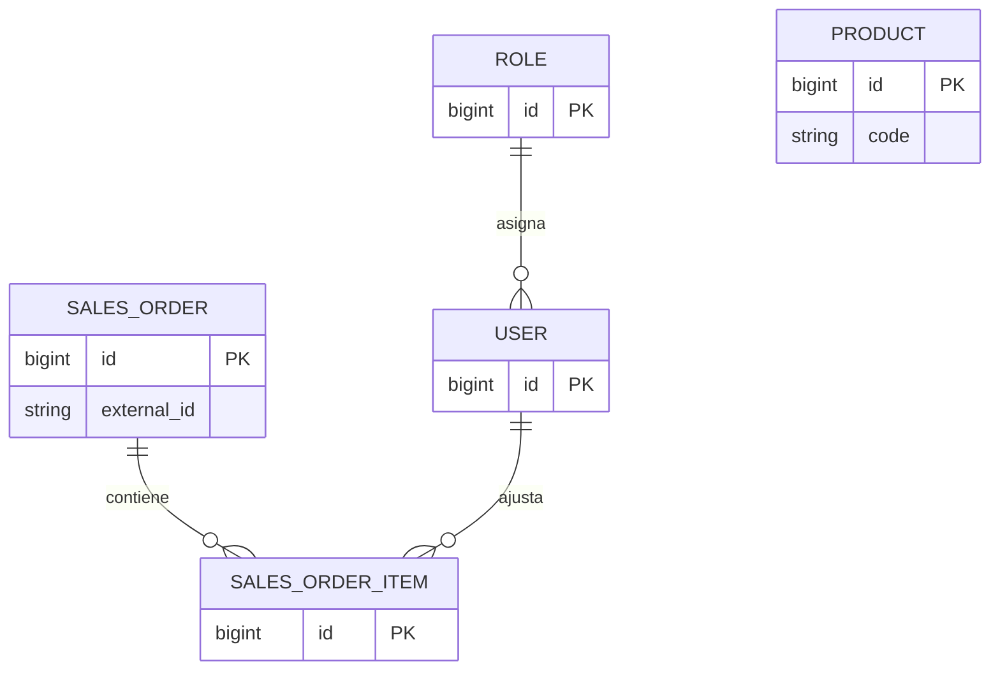

<div align="center">

<br/>

**Sistema interno que sincroniza órdenes desde Contabilium y prepara etiquetas térmicas según la presentación de cada artículo.**


</div>


##  Contenido

[El problema](#-el-problema) · [La solución](#-la-solución) · [Funcionalidades](#-funcionalidades) · [Arquitectura](#-arquitectura) · [Flujos de trabajo](#-flujos-de-trabajo) · [Modelo de datos](#-modelo-de-datos) · [Criterios y decisiones](#-criterios-y-decisiones) · [Stack](#-stack) · [Estructura](#-estructura-del-repo) · [Puesta en marcha](#-puesta-en-marcha) · [Pruebas y calidad](#-pruebas-y-calidad) · [Despliegue](#-despliegue) · [Estado y pendientes](#-estado-y-pendientes) · [Licencia y autoría](#-licencia-y-autoría)


##  El problema

El depósito preparaba pedidos a partir de órdenes de venta que vivían en Contabilium, y las etiquetas dependían de cómo se presentaba cada artículo: por caja, a granel, por unidades, por kilogramos o por cantidad exacta del pedido. Esa lógica no existe en el sistema contable, así que se resolvía a mano, con riesgo de errores de cantidad y de etiquetas incorrectas.

##  La solución

**Iron Screw** es una aplicación Laravel de uso interno, para personal de depósito y administración:

- Sincroniza productos y órdenes desde Contabilium, de forma manual y programada, sin modificar los datos externos.
- Guarda en la base local la configuración operativa: presentaciones, cantidades por caja, ajustes de etiqueta y estado local de cada orden.
- Genera e imprime etiquetas térmicas desde el navegador, por producto o en lote por orden.

Los roles y permisos definen qué puede ver y cambiar cada usuario.


##  Funcionalidades

**Órdenes** (rol: depósito y administración)
- Consulta, búsqueda y paginación de órdenes; las canceladas quedan fuera del flujo operativo.
- Finalización local de órdenes pendientes, conservada frente a sincronizaciones posteriores.
- Importación de cantidades por caja desde XLSX, en una transacción, con plantilla descargable.

**Productos y presentaciones**
- Presentaciones fraccionadas, a granel, por unidades, por kilogramos o por cantidad exacta del pedido.
- Etiquetas de `80 × 50 mm` y `100 × 80 mm`, con ajuste manual de cantidad y número de etiquetas, y registro de quién y cuándo cambió.

**Administración** (rol: administrador)
- Usuarios, roles y permisos por operación.
- Catálogo local sincronizado y registro de resultados de cada sincronización.


##  Arquitectura

Monolito Laravel con vistas Blade del lado del servidor. JavaScript resuelve interacciones locales, el guardado asíncrono de ajustes y la impresión. Los controladores coordinan los casos de uso; Eloquent persiste los datos locales y la copia de la respuesta externa.

Las sincronizaciones completas y del detalle de cada orden corren como jobs en cola. El Scheduler actualiza las órdenes recientes cada 10 minutos y los productos cada hora.






##  Flujos de trabajo

**Sincronización de una orden**



**Impresión de etiquetas por lote**




##  Modelo de datos

Eloquent con 23 migraciones y 5 modelos principales.



Una orden elimina sus artículos en cascada. El usuario que ajustó una etiqueta se conserva en una relación nullable que se anula si ese usuario desaparece. La sustitución del detalle y la importación de cantidades usan transacciones.


##  Criterios y decisiones

- **Contabilium es la fuente comercial, la base local es la operativa.** La configuración de etiquetas y el estado local viven aquí, y no se escriben de vuelta en el sistema externo.
- **Los ajustes locales sobreviven a la sincronización.** Antes de reemplazar artículos, el servicio recupera y vuelve a asociar los ajustes de etiqueta.
- **Un solo proceso de sincronización a la vez.** Un lock de caché evita ejecuciones simultáneas.
- **Pausa ante bloqueos externos.** Si el servicio externo bloquea las solicitudes, el cliente espera 15 minutos antes de volver a intentar.

| Decisión | Por qué |
| --- | --- |
| Monolito Laravel con Blade | Herramienta interna; el código no incluye una API pública ni una SPA. |
| Sincronización con jobs y scheduler | Las llamadas externas no bloquean la interfaz y se reintentan. |
| Permisos por operación | Separan la preparación de pedidos de la administración de usuarios y configuración. |


##  Stack

| Capa | Tecnología | Versión |
| --- | --- | --- |
| Lenguaje | PHP | ^8.3 |
| Backend | Laravel framework | ^13 (lock 13.31.0) |
| Frontend | Tailwind CSS | 4.3.3 |
| Build | Vite | 8.1.5 |
| Importación | XLSX | según `composer.json` |
| Pruebas | PHPUnit | según `composer.json` |
| Base de datos | MySQL | configurada en `.env.example` |


##  Estructura del repo

```text
app/Http/Controllers/   órdenes, productos, usuarios, roles e importación
app/Services/           cliente de Contabilium y sincronización
app/Jobs/               sincronización de productos y órdenes en cola
app/Models/             usuarios, roles, productos y órdenes
database/migrations/    esquema relacional (23)
resources/views/        vistas Blade, etiquetas e impresión
routes/web.php          rutas operativas y administrativas
routes/console.php      programación de sincronizaciones
tests/                  pruebas feature y unitarias (41 métodos de prueba)
```


##  Puesta en marcha

Requisitos: PHP 8.3+, Composer, Node.js, npm y MySQL.

```bash
composer install
npm ci
cp .env.example .env              # credenciales de Contabilium y base, solo en el .env local
php artisan key:generate
php artisan migrate
composer run dev                  # servidor, cola, logs y Vite en paralelo
```

Variables relevantes (por nombre): `DB_*`, credenciales de la API de Contabilium, `QUEUE_CONNECTION`, contraseñas iniciales de usuarios. Ninguno de estos valores se versiona.


##  Pruebas y calidad

La suite tiene 41 métodos de prueba entre feature y unitarias: autenticación y permisos, administración de productos, usuarios y roles, sincronización con respuestas simuladas, cola y circuit breaker, reglas de empaquetado, impresión por lote e importación y exportación XLSX.

```bash
composer test
npm run build
vendor/bin/pint --test
composer audit
npm audit --omit=dev
```

No se publica un resultado de ejecución: en la inspección no estaban instalados `vendor/` ni `node_modules/` y no se instalaron para este cambio. No hay pruebas E2E ni pipeline CI versionados.


##  Despliegue

Pensado para un servidor que exponga solo `public/`. Requiere:

```bash
composer install --no-dev --classmap-authoritative
npm ci
npm run build
php artisan migrate --force
php artisan optimize
php artisan queue:work --sleep=1 --tries=5 --timeout=240 --max-time=3600
```

Además, el Scheduler debe invocarse cada minuto con `php artisan schedule:run`. El repositorio no incluye configuración de un proveedor de hosting, contenedores, supervisor ni copias de seguridad; esos componentes se definen en el entorno de despliegue. HTTPS, permisos del servidor y rotación de credenciales también quedan fuera del código.


##  Estado y pendientes

- **Estado:** sistema interno funcional, con autenticación, sincronización, administración e impresión de etiquetas. Producción no verificada.
- **Último commit:** 2026-08-12, `FIX TAM 80 X 50`, en el historial local.
- **Pendientes:** definir la operación de producción (worker de cola, scheduler, copias de seguridad); ejecutar y publicar el resultado de la suite de pruebas en un entorno con dependencias instaladas.


##  Licencia y autoría

Desarrollado por el **Ing. Santiago Abasto**.


Software propietario, según `composer.json`. La redistribución requiere autorización del cliente, Iron Screw.
